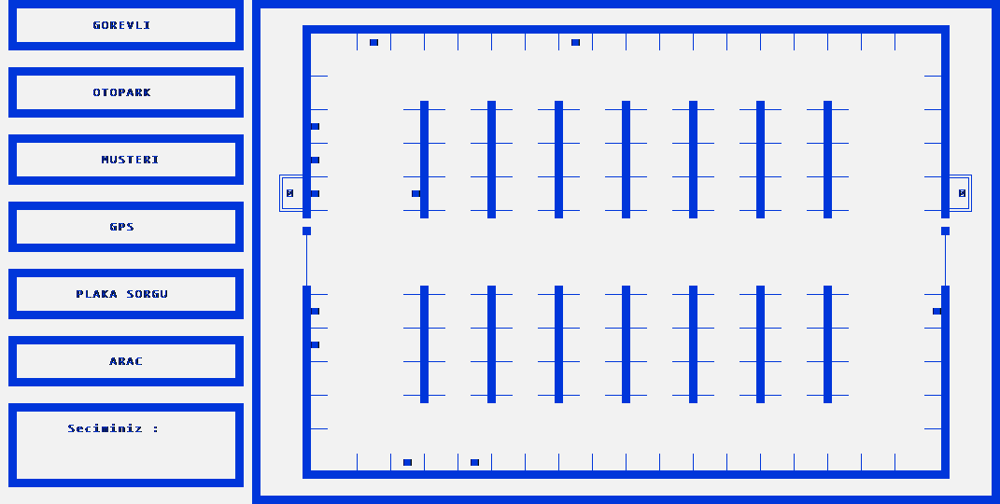
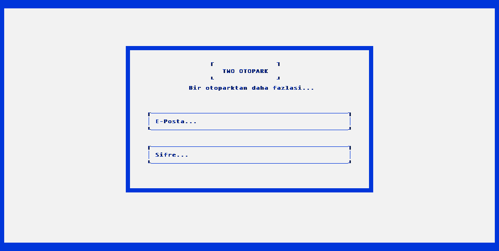
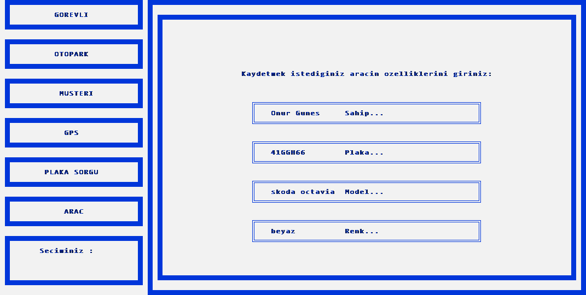
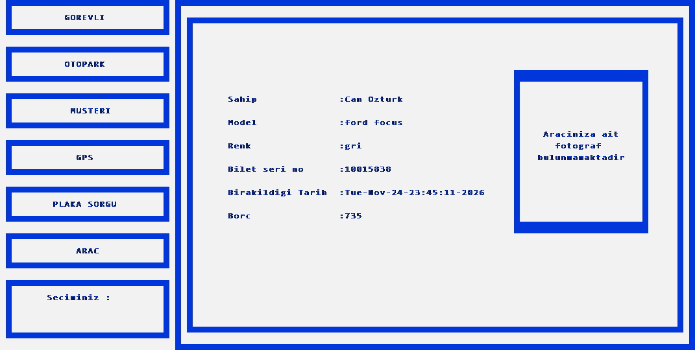
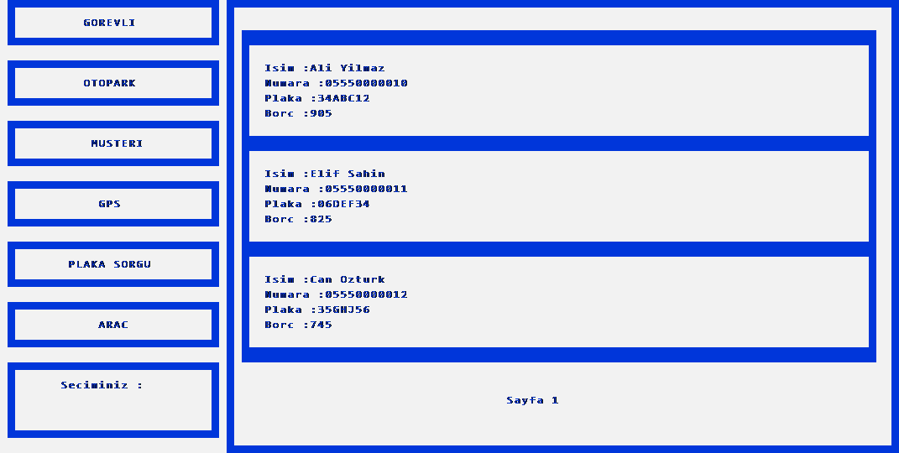
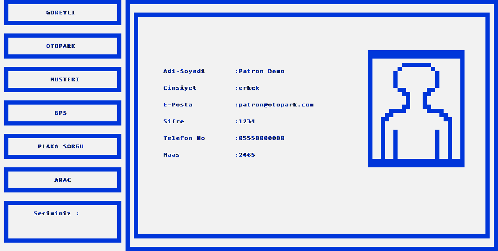
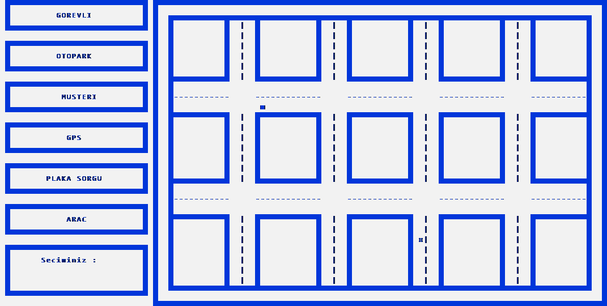

# Otopark Otomasyonu

Windows konsolunda çalışan, C ile yazılmış bir otopark otomasyonu; programdaki adı TWO OTOPARK. Arayüzün tamamı konsolda karakterlerle çiziliyor: giriş ekranı, menüler, otoparkın kuşbakışı planı, kapıların açılıp kapanması ve aracın park yerine gidişi ekranda hareketli olarak gösteriliyor. Kayıtlar düz metin dosyalarında tutuluyor.

## Neden?

Bir otoparkın araç giriş çıkışını, biletlerini, ücretlerini, müşterilerini ve çalışanlarını tek programdan yönetmek için yapıldı.

## Ekranlar

| Giriş | Araç kaydı |
|---|---|
|  |  |
| **Plaka sorgu** | **Müşteri listesi** |
|  |  |
| **Profil** | **GPS** |
|  |  |

Görüntülerdeki kayıtlar örnek veridir. Program bugünkü Windows'ta derlenip çalıştırıldı; araç işareti (♦) yeni konsolda görünmediği için görüntülerde ■ ile gösteriliyor.

## Neler var

- **Giriş:** görevli e-posta ve şifreyle giriyor. Kayıtlı ilk görevli patron, diğerleri çalışan olarak açılıyor. Üç yanlış denemede program kapanıyor.
- **Ana menü:** Görevli, Otopark, Müşteri, GPS, Plaka Sorgu, Araç. Seçim menü adı yazılarak yapılıyor.
- **Araç:** yeni araç kaydı (sahip, plaka, model, renk). Giriş saati yazılıyor, araca ilk boş park yeri ve bir bilet seri numarası veriliyor. Araç çıkışı ve araç listesi.
- **Otopark:** 132 park yerli plan, dolu yerler işaretli. Araç girip çıkarken kapı açılıp kapanıyor, araç yol boyunca park yerine ilerliyor.
- **Plaka sorgu:** plakaya göre sahip, model, renk, bilet seri numarası, bırakıldığı tarih ve borç.
- **Ücret:** 5 birimle başlıyor, her 30 saniyede 10 artıyor.
- **Müşteri:** müşteri ekleme (ad, e-posta, telefon) ve borçlarıyla birlikte sayfa sayfa müşteri listesi.
- **Görevli:** çalışan kendi profilini görüyor; profilde cinsiyete göre karakterlerle çizilmiş bir vesikalık var. Patron çalışan ekleyip çıkarabiliyor ve çalışan listesini görüyor. Patronun profilinde araçlardan gelen ücretlerden maaşlar düşülerek kalan gelir gösteriliyor.
- **GPS:** süresi baştan seçilen küçük bir kovalamaca oyunu. Ok tuşlarıyla sokaklarda ilerleyip kaçan hırsızı süre bitmeden yakalamak gerekiyor.

## Teknik

| | |
|---|---|
| **Dil** | C, Windows konsolu (`conio.h`, `windows.h`) |
| **Proje** | Code::Blocks (`TWO OTOPARK.cbp`) |
| **Kod** | `main.c` giriş ve menü döngüsü, `Twootopark.h` bütün ekranlar ve işlemler |
| **Veri** | `aracbilgileri.txt`, `biletstruct.txt`, `musteribilgileristruct.txt`, `gorevlikayitstruct.txt` |
| **Tarih** | Mayıs 2021 |
